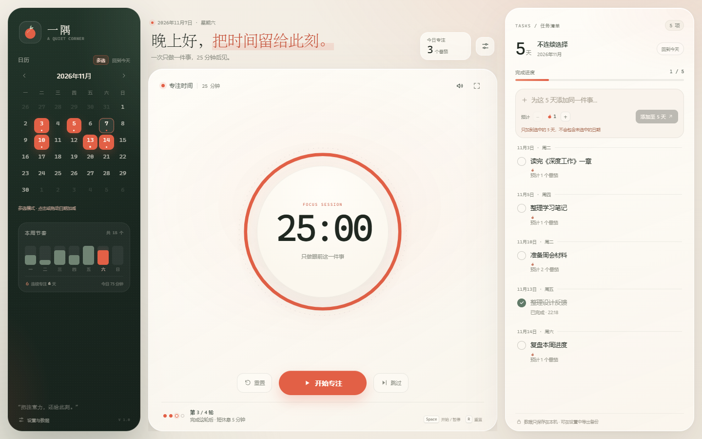

# 一隅专注 · Yiyu Focus

> 把 25 分钟交给一件事。

一个离线、零依赖的番茄专注与任务日历。没有账号、没有云同步、没有网络请求；打开即用，数据只留在你的浏览器里。

**在线使用：** <https://starseye.github.io/yiyu-focus/>



## 功能

- **番茄钟**：默认 25 分钟专注 + 5 分钟短休息，每 4 轮进入 15 分钟长休息；时长和轮数都可以调整。
- **可靠计时**：使用绝对结束时间记录，切到别的窗口、页面刷新也不会打乱计时。
- **任务清单**：按日期添加任务，设置预计番茄数，完成后自动累计该任务的番茄。
- **日历多选**：拖动框选连续多天，也可以选择不连续的日期，一次把任务加到选中的每一天。
- **专注统计**：本周每天的番茄数、连续专注天数、今天累计专注分钟数。
- **专注模式**：隐藏日历和任务栏，只留下计时器。
- **结束提醒**：提示音和可选的桌面通知。
- **数据管理**：运行状态与学习记录分开管理，记录清理支持每天、每周、每月或仅一次的自定义时间，并且可以撤销。
- **纯本地**：所有数据保存在浏览器 `localStorage`，不会上传到任何服务器。

## 在线使用

直接打开：

<https://starseye.github.io/yiyu-focus/>

也可以把它当作一个网页应用使用。在线版和本地 `file://` 版使用不同的浏览器存储，数据互不相通；选择一种方式长期使用，并定期导出备份即可。

## 本地使用

这个项目没有构建步骤，也不需要安装依赖。

1. 下载或克隆仓库。
2. 双击 `index.html`，用浏览器打开即可。

### Windows 独立窗口

在 Windows 上，可以双击 `启动一隅专注.vbs`，它会在 Microsoft Edge 的应用窗口中打开，像桌面软件一样使用。也可以右键这个文件，发送到桌面快捷方式。

如果想手动创建快捷方式，目标是：

```text
msedge.exe --app="file:///你的路径/index.html" --start-maximized
```

应用在 Edge、Chrome 等现代浏览器中可以正常运行。

## 数据与隐私

- 数据保存在浏览器本地的 `localStorage`，不会上传。
- 换浏览器、换设备或换地址打开时，会是另一份数据；可以用「导出备份 / 导入备份」迁移。
- 浏览器清理「站点数据 / Cookie 和其他站点数据」、使用隐私窗口，都可能删除数据。应用无法阻止浏览器执行这种清理。
- **记录数据默认不会被自动删除。**「设置与数据 → 数据与清理 → 学习记录自动清理」默认关闭；开启后才会按你设定的时间清空任务和专注记录，保留设置，并支持 12 秒内撤销。
- 运行状态默认在每次打开应用时重置，只影响计时器、当前任务和日期选择，不会删除任务或专注记录。
- 最可靠的保护方式是定期导出 JSON 备份。

## 项目结构

| 文件 | 用途 |
| --- | --- |
| `index.html` | 应用入口与界面结构 |
| `styles.css` | 全部界面样式 |
| `app.js` | 计时、任务、日历、统计和本地存储逻辑 |
| `启动一隅专注.vbs` | Windows 独立应用窗口启动器 |
| `favicon.svg` | 网页图标 |
| `一隅专注.ico` | Windows 图标 |
| `预览.png` | README 界面预览 |

## 技术说明

- 纯静态单页应用：HTML + CSS + 原生 JavaScript。
- 无框架、无构建步骤、无第三方运行时依赖、无网络请求。
- 使用 `localStorage` 做本地持久化，使用 Web Worker 辅助后台计时。
- 设计风格为纸张质感、森林绿与番茄红，支持桌面与移动宽度的响应式布局。

## English

Yiyu Focus is a local-first Pomodoro timer and task calendar with a calm, paper-like interface. It is a single-page app built with vanilla HTML, CSS and JavaScript — no build step, no dependencies and no network requests. The interface is in Chinese. Data stays in your browser via `localStorage`.

Live demo: <https://starseye.github.io/yiyu-focus/>

## License

[MIT](LICENSE) © 2026 starseye

如果这个项目对你有帮助，欢迎点一个 Star。